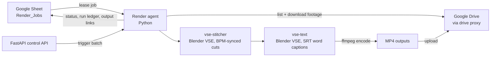

# SF Production — sheet-driven video render pipeline

**Batch video production infrastructure: a producer queues jobs, the pipeline renders consistent, on-brief edits at volume, and a person stays in control of what ships.**

| Production need | How this handles it |
|---|---|
| High-volume runs with consistent quality | A job queue with leasing, so several render agents work concurrent streams without duplicating or dropping work |
| Reproducible output | Every edit is seeded and preset-driven: the same seed, inputs and preset give the same result, so a look can be re-run or tweaked one parameter at a time |
| A defined visual language | Cut rhythm and caption typography (font, size, tracking, line spacing, alignment, safe margins, per-word layout, pixelate treatment) live in versioned preset files, not in someone's head |
| Local and cloud execution | Runs on a workstation or in a container on a cloud VM from the same code, with fail-fast preflight checks |
| Organized delivery | Renders upload to the right Drive folder and are indexed back to the job with status and links |

An automated pipeline that turns a row in a Google Sheet into finished, beat-synced music-video edits. A producer fills in a job (song, footage folder, BPM, aspect ratio, text style). A render agent leases the job, pulls the footage from Google Drive, cuts and stitches it in **Blender's Video Sequence Editor** on the beat, burns in word-by-word lyric captions from an SRT, uploads the renders back to Drive and writes status and output links to the sheet.

It was built to make short-form video for an independent music release without hand-editing each cut.



## What's in here

| Directory | What it is |
|---|---|
| [`script-orchestrator-sync/`](script-orchestrator-sync/) | The orchestration layer: a FastAPI control API, a sheet-to-sheet sync engine, and the render agent that leases jobs, resolves inputs, calls Blender and uploads results. Containerized with a pinned Blender runtime and ffmpeg. 118 tests. |
| [`vse-stitcher/`](vse-stitcher/) | Headless Blender script that builds a timeline from a folder of clips, cutting on the beat for a given BPM and preset. It's deterministic: the same seed, inputs and preset give the same edit. Outputs 9:16 or 16:9. |
| [`vse-text/`](vse-text/) | Headless Blender script that overlays timed lyrics from an SRT file. Each word is its own text strip with a fixed layout, plus optional pixelate and blur effects. Styles are plug-in presets in `scripts/presets/`. |

## Engineering highlights

- **Sheets as the control plane.** Non-technical collaborators queue, prioritize and re-run renders from a spreadsheet. The code reads and writes through a small JSON gateway ([sheets-json-gateway](https://github.com/metrothenews/sheets-json-gateway)) instead of calling the Sheets API directly.
- **Job leasing and an idempotent run ledger.** Jobs are leased with an owner and expiry, so several agents can run without double-rendering. Runs move through `queued → running → success | failed | retry`. Each run gets a `run_id`, a source fingerprint and a dedupe key.
- **Deterministic rendering.** Frame timing uses integer milliseconds (`frame = 1 + floor((ms*fps + 500)/1000)`) with end-exclusive ranges, so captions never drift or overlap. Seeded randomness makes edits reproducible.
- **Preset-driven creative control.** Cut style and caption look are data (Python preset dicts merged over defaults), so a new look doesn't need changes to the pipeline.
- **Production-minded ops.** Docker Compose for dev (hot reload) and prod, a VM deploy script with a health-check gate, fail-fast startup checks for credentials and render binaries, and `make` targets for preflight, bootstrap and smoke tests.

## Applications at scale

The pipeline is a general **programmatic video engine**, not a one-off script. The same architecture covers:

- **Creative automation for short-form video.** One template plus a folder of footage yields any number of distinct, on-beat edits. That's the workload behind ad-creative testing, UGC-style campaigns and catalog marketing, where volume and variation matter more than a single hero cut.
- **An execution layer for generative media.** Today the inputs are camera footage and human-written lyrics. The job contract doesn't care where they come from: clips from a text-to-video model and captions from an LLM or speech-to-text model drop into the same stitch → caption → encode stages. Leasing, retries and the run ledger are the reliability layer that non-deterministic models need around them.
- **Agent-operable production.** Jobs are structured rows and an HTTP API, so an AI agent can queue, monitor and requeue renders the same way a producer does, with a human approving in the sheet.
- **Localization and reformatting.** Swapping the SRT gives a new language; swapping the canvas gives 9:16 or 16:9. Both are data changes, not edits.

**What it demonstrates:** distributed job orchestration, idempotency and state machines, deterministic media processing, human-in-the-loop workflow design, containerized deployment, test discipline (118 tests).

## Running it

See [`script-orchestrator-sync/README.md`](script-orchestrator-sync/README.md) for setup, environment variables, Docker and the smoke tests. The quickest local check:

```bash
cd script-orchestrator-sync
python3 -m venv .venv && source .venv/bin/activate
pip install -r requirements.txt
PYTHONPATH=src:scripts python -m pytest -q tests
```

The Blender scripts run headless, for example:

```bash
blender -b --python vse-stitcher/scripts/vse_bpm_preset_deterministic_bl456.py -- \
  --media-root ./clips --audio ./song.wav --bpm 140 --width 1080 --height 1920 --seed 7 --output ./out.mp4
```

Rendered media, audio and logs aren't committed. Point the scripts at your own footage.

## Stack

Python · Blender 4.x VSE (`bpy`) · ffmpeg · FastAPI · Google Sheets / Drive APIs · Docker · Google Cloud Run / Compute Engine
